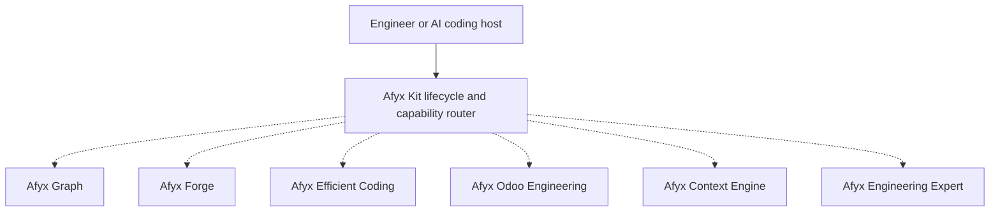

# AFYX Engineering Kit

**Local-first engineering intelligence, adaptive guidance, and evidence-driven validation for AI coding agents.**

> **Individually Reliable. Collectively Solid.**
>
> **Evidence-Led Guidance. Bounded Scopes. Strict Integrity. Reproducible Acceptance.**
>
> **Standalone by Design. Integrated by Contract. Activated by Need.**

AFYX Engineering Kit unites six independent engineering products in a
modular ecosystem for AI-assisted software development. Use each product
on its own or combine eligible capabilities through shared installation and
routing contracts. The design prioritizes source evidence, permission boundaries,
focused validation, and failure isolation over unqualified automation claims.

**Status:** Technical Alpha · **Full runtime tested:** Windows x64 and Linux x64
(WSL2 Ubuntu) · **macOS/ARM Full:** no bundled Graph archive; runtime untested ·
**Integration:** Optional and task-driven.

Graph, Forge, Context Engine, and Engineering Expert provide four foundational
engineering pillars. Efficient Coding and Odoo Engineering are **equally
recognized standalone products**, not merely auxiliary documentation.

## Why Afyx

Ordinary coding assistants can generate plausible changes while leaving the
engineer to establish repository structure, impact, version-specific behavior,
and acceptance evidence. Afyx adds reusable engineering controls around that
workflow:

- **Structural repository intelligence** with verifiable file, symbol, call-path,
  dependency, impact, and index-health evidence.
- **Cross-disciplinary engineering orchestration** that selects only the product,
  architecture, security, data, reliability, implementation, ERP, or QA guidance
  relevant to the task.
- **Fail-closed evaluation contracts** for controlled engineering comparison and
  evidence handling.
- **Optional context reduction with exact-original recovery**, never replacing the
  original when doing so would be unsafe or more expensive.
- **Transactional installation and recovery** with ownership boundaries, preview,
  verification, backup, update, and uninstall behavior shared across platforms.

Afyx is aimed at engineers and technical owners who value source evidence,
bounded change, explicit limitations, and reproducible acceptance more than
unqualified automation claims.

## Six standalone Afyx products

The ecosystem consists of **six independently usable products**. Each provides
a distinct engineering capability; no product requires the whole Kit. An installed
capability is selected only when relevant, healthy, and authorized.

| Product | Core capability | Implementation and maturity |
|---|---|---|
| [**Afyx Graph**](afyx-graph/engine/README.md) | Local indexing, structural code intelligence, symbol/dependency navigation, impact and affected-test analysis, CLI and optional MCP. | **Standalone Node.js runtime · Technical Alpha**; static evidence requires runtime/test verification. |
| [**Afyx Forge**](afyx-forge/README.md) | Deterministic task classification, engineering policies, bounded plans, and diagnostics through Forge Core; distinct evaluation infrastructure. | **Standalone Node.js CLI/API v0.1.0 · Technical Alpha**; bounded local assistive planning approved, not autonomous code changes; historical 36-cell evaluation remains `NOT_RUN`. |
| [**Afyx Efficient Coding**](docs/tool-guides/AFYX_EFFICIENT_CODING.md) | Evidence-led coding, debugging, refactoring, focused validation, and engineering reporting. | **Standalone agent skill v1.2.2 · Implemented**; guidance, not an execution engine. |
| [**Afyx Odoo Engineering**](docs/tool-guides/AFYX_ODOO_ENGINEERING.md) | Odoo-specific ORM, views, security, module development, migration, and troubleshooting. | **Standalone agent skill v1.2.0 · Implemented**; reference coverage Odoo 10–20, with target-version verification required. |
| [**Afyx Context Engine (ACE)**](afyx-context/README.md) | Conservative context reduction, local storage, integrity checks, and exact-original recovery. | **Standalone Node.js runtime v0.1.0 · Technical Alpha**; explicit Kit selection, no universal savings guarantee. |
| [**Afyx Engineering Expert**](skills/afyx-engineering-expert/README.md) | Adaptive engineering guidance across 13 disciplines and six optional workflows. | **Standalone agent skill v0.1.1 · Implemented**; final D.6 substantive acceptance remains pending. |

### Platform services and supporting utilities

The cross-platform **installer, updater, verifier, doctor, and capability router**
are shared Kit infrastructure, **not separate products**. Optional Windows
[Afyx Codex Usage Tracking](docs/CODEX_USAGE_TRACKER.md) is a seventh registered
observability utility, not one of the six primary engineering products.

The [component registry](scripts/components.json) is authoritative for
installable IDs, presets, supported platforms, and ownership. Consult the
[Component Guide](docs/COMPONENTS.md) for detailed functionality and limitations.

## How the products fit together



**Diagram legend:** The solid arrow shows the Kit entry point; dashed arrows
mean **optional, task-scoped selection**, not automatic activation or a claim
that every provider integration has passed acceptance. Every Afyx product can
also run independently through its advertised interface. Installation alone
does not imply execution; user-disabled capabilities remain disabled.

Registry-based routing and interaction contracts have source-level
implementations. Full installed-host interoperability is not claimed as
accepted. Graph-to-ACE automatic MCP interception remains default **OFF**;
Forge Core offers assistive plans and has no autonomous execution authority.
The [interoperability contract](docs/AFYX_UNIVERSAL_COMPONENT_INTEROPERABILITY.md)
distinguishes approved target behavior from proven current behavior.

## Current product status

This repository is a **Technical Alpha prerelease**. It is not Stable v1, no
formal public Alpha approval is implied, and publisher authenticity remains
unverified unless an artifact has an independently verified attestation.

- Graph, the Kit lifecycle, ACE, Efficient Coding, Odoo Engineering, and
  Engineering Expert have implemented runtime or skill contracts with regression
  evidence appropriate to their respective interfaces.
- ACE and Forge are included in the Full preset; Minimal and Recommended omit
  them. Installation does not grant autonomous execution. Healthy installed ACE
  is used only for eligible on-demand work and respects explicit OFF.
- Automatic Graph–ACE MCP interception remains unproven/default OFF; optional
  consumer paths have exact-original fallback. Context measurements include
  positive and negative net results—no universal savings claim is made.
- Forge Core has a real standalone assistive CLI/API and explicitly selectable
  runtime on supported installation paths. This is distinct from the formal Forge
  B0–B5 evaluator campaign: its 36 cells remain `NOT_RUN`; the Owner's A8 GO
  applies only to bounded local assistive planning, never autonomous execution.
- Engineering Expert is usable as a skill, while final D.6 substantive review is
  still outside the accepted claims.

**Verified CI checkpoint (2026-11-05):** the `dev` merge
[`e332230`](https://github.com/a5zero7/afyx-engineering-kit/commit/e332230a2c0ba162b447af1359cf591057ce26b6)
closed a Windows Vitest hook-timeout regression. The four post-merge workflows
reported `SUCCESS`: [Graph Build](https://github.com/a5zero7/afyx-engineering-kit/actions/runs/41988333699),
[Kit CI](https://github.com/a5zero7/afyx-engineering-kit/actions/runs/41988333765),
[Windows Installer](https://github.com/a5zero7/afyx-engineering-kit/actions/runs/41988333733), and
[Phase 8 Dogfood](https://github.com/a5zero7/afyx-engineering-kit/actions/runs/41988333780).
This is a CI checkpoint, **not** independent installed-product or Stable v1 acceptance.

See [Product Vision](docs/PRODUCT_VISION.md) for the maintained product contract
and [Component Guide](docs/COMPONENTS.md) for capability and limitation details.

## Install AFYX Engineering Kit — Windows & WSL2

### Public npm Alpha (pending release clearance)

With Node.js 22.5 or newer, the intended public registry command is:

```bash
npx afyx-engineering-kit install
```

Use `--preset recommended` for core engineering skills or `--preset full`
for the prebuilt Graph, Context, Forge, and applicable skills. `full` requires
Windows x64 or Linux x64 for Graph. Provider configuration is optional and
remains subject to each host's native prerequisites. Confirm the intended Alpha
version with `npm view afyx-engineering-kit@latest version`. Until the registry
lists a cleared release, use the GitHub prerelease tarball below.

### Local Developer Setup (Bare NPX Resolution)

For local development or offline environments where `npx afyx-engineering-kit install` must resolve without contacting public registries:

Windows 11 (PowerShell 7):
```powershell
.\scripts\link-global-dev.ps1 -Install
.\scripts\link-global-dev.ps1 -Verify
```

WSL2 Ubuntu (Bash):
```bash
./scripts/link-global-dev.sh --install
./scripts/link-global-dev.sh --verify
```

Once linked, bare `npx` resolves locally from any directory completely offline:
```bash
npx afyx-engineering-kit install --preset full --skip-provider-configuration
```

To remove the link:
```powershell
.\scripts\link-global-dev.ps1 -Uninstall
```

### GitHub prerelease tarball fallback

The GitHub-generated `dev.zip` is a source snapshot. It does not include the
revision-matched Graph runtime needed by the Full preset. A Windows x64 Full
release ZIP is built separately from an immutable commit with a verified Graph
archive and `.afyx-source-revision` marker. Its download link will be added
after the public release and anonymous installation checks pass. Node.js 22.5+
is required; Windows PowerShell 5.1 and PowerShell 7 are the intended hosts.

Alternatively, use the prebuilt tarball from the [v0.1.0-alpha.2 GitHub prerelease](https://github.com/a5zero7/afyx-engineering-kit/releases/tag/v0.1.0-alpha.2):

```bash
npm exec --yes --package="https://github.com/a5zero7/afyx-engineering-kit/releases/download/v0.1.0-alpha.2/afyx-engineering-kit-0.1.0-alpha.2.tgz" -- afyx-engineering-kit install --preset full --no-build-fallback --non-interactive --skip-provider-configuration
```

`full` installs the prebuilt Graph runtime, Context, Forge, and applicable
skills. Provider configuration is skipped by the example; select a supported
provider explicitly when you are ready to register its MCP integration. Verify
the installation with the same `npm exec --package=... --` prefix followed by
`afyx-engineering-kit verify --preset full`. Run `afyx-engineering-kit update`
with that prefix for an ownership-aware update, or `afyx-engineering-kit uninstall`
with an explicit component to remove it. See the [installation guide](docs/INSTALLATION.md)
for provider selection, recovery, and platform limits.

## Quick start

### Prerequisites

- Git.
- Windows PowerShell 5.1+ / PowerShell 7, or Bash 3.2+ on Linux/macOS.
- Supported AI coding host (Codex, Antigravity, or Claude Code; or run host-independent).
- Node.js 22.5+ when selecting Afyx Graph, ACE, or Forge Core.
- npm only when a local build fallback is needed.

### 1. Clone and preview

Windows:

```powershell
git clone https://github.com/a5zero7/afyx-engineering-kit.git
Set-Location afyx-engineering-kit
.\install.ps1 -ValidateOnly
.\install.ps1 -WhatIf -Preset recommended
```

Linux or macOS:

```bash
git clone https://github.com/a5zero7/afyx-engineering-kit.git
cd afyx-engineering-kit
./install.sh --validate-only
./install.sh --dry-run --preset recommended
```

Preview is non-mutating. Inspect every destination and planned action before
continuing.

### 2. Select an actual preset

| Preset | Desired components |
|---|---|
| `minimal` | Efficient Coding, Odoo Engineering |
| `recommended` | Minimal + Afyx Engineering Expert |
| `full` | Recommended + Afyx Graph, Context, Forge, and Windows-only Usage Tracking |
| `custom` | Only components repeated with `CustomComponent` / `--custom-component` |

ACE and Forge Core are included only in `full`. Installation does not authorize autonomous
Forge execution or automatic Graph MCP interception:

```powershell
.\install.ps1 -Preset custom -CustomComponent afyx-context -Confirm:$false
.\install.ps1 -Preset custom -CustomComponent afyx-forge -Confirm:$false
```

```bash
./install.sh --preset custom --custom-component afyx-context
# Forge Core has a dedicated standalone Unix installer:
./scripts/install-afyx-forge.sh --validate-only
```

Install Recommended:

```powershell
.\install.ps1 -Preset recommended
```

Supported AI coding host integrations include Codex, Antigravity, and Claude Code
(both standalone CLI and VS Code extension-only). Native provider-aware onboarding
registers integrations without changing credentials, models, or host routing:

```powershell
.\install.ps1 -Preset full -Provider codex,antigravity,claude -ProviderScope workspace -WorkspaceRoot (Get-Location)
```

Antigravity-only plans exclude the Codex Usage Tracking component. See the
[Installation Guide](docs/INSTALLATION.md#provider-aware-onboarding) for global
IDE/CLI skill paths, dry-run, verification, and ownership-safe rollback.

```bash
./install.sh --preset recommended
```

Open a new Codex session after skill installation.

### 3. Verify

```powershell
.\verify.ps1 -Preset recommended
.\scripts\afyx-doctor.ps1 -ProjectPath .
```

```bash
./verify.sh --preset recommended
./scripts/afyx-doctor.sh --project .
```

`verify` checks the desired lifecycle state. `doctor` reports local environment
and project diagnostics without installing, repairing, or calling a model.

## First useful workflows

### Discover and navigate a repository

```bash
afyx-graph init . --yes
afyx-graph query getAfyxGraphDir --path .
afyx-graph explore "external state database lifecycle" --path . --max-files 4
```

### Review change impact

```bash
afyx-graph impact getAfyxGraphDir --path . --depth 2
afyx-graph affected --path . src/directory.ts
```

Graph output is static repository evidence. It does not prove runtime behavior;
run the relevant tests and runtime checks before accepting a change.

### Plan a substantial engineering task with Forge Core

After installing the explicitly selected Forge runtime, ask it for a bounded
plan; it does not edit source files or execute tests on your behalf:

```bash
afyx-forge doctor
afyx-forge plan --task "Trace a cross-module data consistency regression" --format markdown
```

For source and full usage, see [Forge Core](afyx-forge/README.md). A planned
validation checklist is **not** a completed validation or formal A8 verdict.

### Ask for a cross-disciplinary review

```text
Use afyx-engineering-expert to review this authentication change. Cover the
architecture, threat boundary, operational failure modes, and acceptance tests;
load only the relevant disciplines.
```

For Odoo implementation facts, pair Expert with Odoo Engineering and establish
the target Odoo major version from repository or runtime evidence.

### Reduce and recover exact content with ACE

```bash
afyx-context reduce --state /absolute/owned/ace-state --owner local-owner \
  --session reviewed-source-sha --input request.json --budget 16000
afyx-context get --state /absolute/owned/ace-state --owner local-owner \
  --session reviewed-source-sha --reference 'ace:v1:...'
```

ACE state is local plaintext and must be protected by host filesystem controls.
References are owner/session-bound, and retrieval verifies the stored digest.

## Lifecycle and safety

The installer inventories before mutation and distinguishes `NOT INSTALLED`,
`HEALTHY`, `INCOMPLETE`, `INVALID`, `DRIFTED`, and `UNKNOWN`. Unknown or foreign
ownership is not silently adopted. Update/repair uses staging, validation,
backup, atomic promotion, and rollback. Project Graph indexes, credentials,
providers, models, unrelated MCP entries, and external tools are preserved.

- Safe installation, update, uninstall, and recovery: [Installation Guide](docs/INSTALLATION.md)
- Component capabilities and troubleshooting: [Component Guide](docs/COMPONENTS.md)
- Read-only diagnostics: [Diagnostics](docs/DIAGNOSTICS.md)
- Product principles and maturity: [Product Vision](docs/PRODUCT_VISION.md)
- Canonical development plan: [Afyx v1 Master Roadmap](docs/AFYX_V1_MASTER_ROADMAP.md)
- Benchmark scope and interpretation: [Benchmarks](docs/BENCHMARKS.md)

## License and third-party boundaries

License scope must be checked **per package**. The Kit root, Graph and ACE are
MIT-licensed in their respective license/metadata files; the standalone Forge
Core package currently declares `Apache-2.0` in `afyx-forge/package.json`.
Do not infer one blanket license from the umbrella README. The Phase 5/AFYX-320
native Graph/UI replacement and provenance review are recorded as completed
for their declared artifact boundary, not as a legal guarantee about every
future dependency or distribution. External tools remain under their own terms;
retain required notices and review provenance before release.
