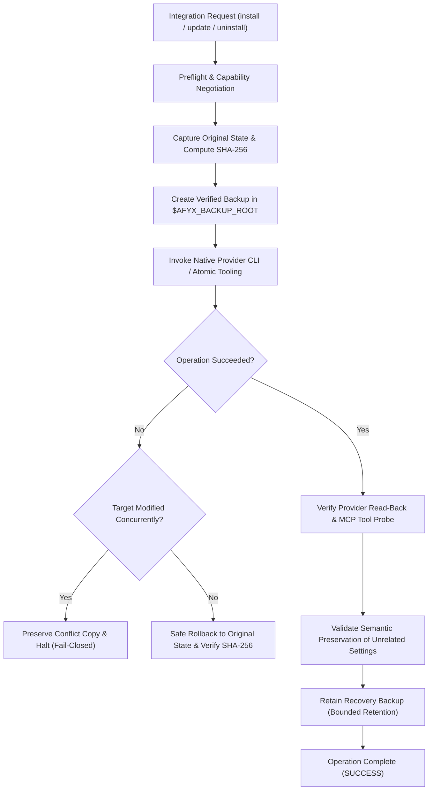

# AFYX Universal Provider Configuration Management Policy

**Document Version:** 1.0.0
**Effective Date:** 2026-11-09
**Status:** Canonical Engineering Policy
**Scope:** Universal across all supported and future AI provider hosts (Codex, Antigravity, Claude Code, and extensible adapters)

---

## 1. Core Principle & Philosophy

AFYX Engineering Kit operates under a singular, provider-agnostic configuration principle:

> **"Native Integration First. Backup Before Modification. Validate After Changes. Restore When Needed."**

### 1.1 Authorized Configuration Modification
AFYX is explicitly authorized to inspect, plan, register, update, and remove its owned integration entries in existing, default, or user provider configuration files (such as `config.toml`, `mcp_config.json`, `.claude.json`, `.mcp.json`) when required for supported integrations.

### 1.2 Normalization vs. Data Corruption
- **Exact byte-for-byte preservation of original configuration files is NOT a default acceptance requirement**, unless explicitly required by a specialized test or contract.
- Provider-native tooling (e.g., `codex mcp add`, `claude mcp add-json`) deserializes configuration documents and re-serializes them upon completion.
- Normalization phenomena—including:
  - Reordering of keys and tables;
  - Reformatting of whitespace, indentation, or newlines;
  - Normalization of quoting (single vs. double quotes);
  - Stripping or reformatting of comments during CLI round-tripping;
  - Character encoding canonicalization (UTF-8 BOM vs. standard UTF-8);
  are recognized as **harmless provider-native normalization**, **NOT** data corruption or integration defects.
- Successful integrations MUST NOT be blocked merely because provider tooling normalized formatting or stripped comments, provided all functional settings remain intact.

---

## 2. Universal Integration Architecture

1. **Native Integration First:** Always prefer official provider CLIs (`codex mcp`, `claude mcp`), APIs, and canonical configuration interfaces over custom, unapproved file manipulators.
2. **Standard-Library & Shared Utilities:** Provider backup, rollback, and validation logic is centralized in `scripts/afyx-provider-backup.mjs`. Provider-specific details remain encapsulated inside dedicated provider adapters (`afyx-mcp-integration.mjs`, `afyx-claude-integration.mjs`, `afyx-provider-integration.mjs`).
3. **Fail-Closed on Unowned Entries:** AFYX never modifies, claims, or overwrites unowned or foreign provider entries without explicit consent.

---

## 3. Backup & Recovery Contract

Before performing any configuration-changing operation (`install`, `update`, `uninstall`, `repair`):

### 3.1 Pre-Modification Capture & Backup Creation
1. **Target Identification:** Identify affected configuration paths and active provider ownership boundaries.
2. **State & Digest Capture:** Determine whether the target file exists. If it exists, read raw original bytes and calculate its SHA-256 digest (`originalSha256`).
3. **External Location:** Create a timestamped, nonce-protected backup file located strictly **outside the source repository**:
   - Canonical root: `$AFYX_BACKUP_ROOT/provider-config/<provider>/` (falling back to `~/.afyx/backups/provider-config/<provider>/`).
   - File naming: `<config-filename>.<timestamp>-<nonce>.bak`.
4. **Metadata Preservation:** Write a companion JSON manifest (`<backup-file>.meta.json`) recording:
   - `schemaVersion`: 1
   - `provider`: Provider identifier
   - `configPath`: Absolute path to configuration
   - `operation`: Operation name
   - `timestamp`: ISO-8601 UTC timestamp
   - `existed`: Boolean existence flag
   - `sha256`: Original SHA-256 digest
   - `size`: Byte count
   - Permissions (file mode) preserved on disk.
5. **Preflight Backup Integrity Verification:** Read back the created backup immediately and verify its SHA-256 matches `originalSha256`. If the verification fails, abort the operation immediately before modifying the target configuration.

### 3.2 Bounded Backup Retention
- On successful operations, **retain the recovery backup** rather than deleting it.
- Enforce bounded retention (default: 20 newest backups per provider, configurable via `AFYX_BACKUP_LIMIT`).
- Prune the oldest backups exceeding the retention threshold without disrupting active configurations.

### 3.3 Safe Rollback & Concurrent-Edit Protection
If an operation fails at any step after native invocation:
1. **Check for Concurrent Modifications:**
   - Read current target bytes and compute `currentSha256`.
   - If `currentSha256` differs from both `originalSha256` and `lastKnownSha256` (the state immediately produced by our last known command), an external/concurrent edit is detected.
   - **Protection Rule:** Refuse blind rollback. Preserve the concurrently modified file as `<configPath>.conflict-<timestamp>-<nonce>` and return `CONCURRENT_MODIFICATION_DETECTED` with conflict diagnostic paths.
2. **Clean Rollback:**
   - If no concurrent modification occurred, restore the target from the verified backup bytes (or remove the file if it did not originally exist).
   - Verify that the restored file's SHA-256 exactly matches `originalSha256`.

### 3.4 Explicit Restore Procedure
- A standard restoration function (`restoreFromBackup(backupPath, targetPath)`) allows operators to explicitly recover any prior configuration snapshot.
- Restored files are verified against the companion `.meta.json` checksum.

### 3.5 Uninstall Rules
- During normal uninstallation, remove only AFYX-owned entries using native provider mechanisms (`mcp remove`).
- **Do NOT blindly restore a historical configuration file during uninstall**, as doing so would erase unrelated settings or credentials added by the user after AFYX was installed.

---

## 4. Change Validation & Acceptance Criteria

Post-integration verification must evaluate:

1. **Provider Recognition:** The provider host recognized its updated configuration without syntax or schema errors (`readExisting`, `claude mcp get`, or provider read-back).
2. **AFYX Entry Active:** The AFYX integration entry is active, correctly configured with direct runtime paths, and flagged with ownership markers.
3. **Runtime Tool Probe:** Expected runtime tools (e.g., `afyx_graph_explore`, `afyx_workflow`) respond successfully over the stdio MCP transport.
4. **Semantic Preservation of Unrelated Settings:**
   - **JSON Providers (Antigravity, Claude Code):** Parse JSON before and after, remove AFYX server entries, and verify that all other keys, tools, and options are identical.
   - **TOML Providers (Codex):** Verify that all unrelated tables (e.g., `[unrelated]`, `[mcp_servers.headroom]`) and key-value pairs (e.g., `model = "..."`) remain present and functional.
5. **Destructive Loss Reporting:** If native provider tooling drops unknown keys or deletes foreign server entries, the integration MUST report the specific missing tables/keys and fail closed with diagnostic evidence.

---

## 5. Alignment with Gate G6 (Provider Configuration Preservation)

Under this universal policy, the G6 Codex provider integration blocker is resolved and governed as follows:

| Verification Requirement | Implementation Evidence | Acceptance Rule |
| :--- | :--- | :--- |
| **Pre-Modification Backup** | Created in `$AFYX_BACKUP_ROOT/provider-config/codex/` with SHA-256 metadata before native invocation | **PASS** when verified on disk |
| **Original Config Recoverable** | Verified byte-level recovery via `rollbackConfiguration` and `restoreFromBackup` | **PASS** when verified by test |
| **Native Codex MCP Add** | Executed through `codex mcp add afyx_graph -- node <entry> serve --mcp` | **PASS** upon exit 0 and read-back |
| **Native Codex MCP Remove** | Executed through `codex mcp remove afyx_graph` | **PASS** upon exit 0 and entry absent |
| **Functional MCP Features** | Validated via `probeMcp` with `afyx_graph_explore` tool handshake | **PASS** when probe succeeds |
| **Normalization Tolerance** | TOML re-serialization by Codex CLI accepted; exact byte equality is not required | **PASS** if unrelated tables/keys match |
| **Concurrent Change Protection** | External edits preserved to `.conflict-*` during aborted rollback | **PASS** when verified by negative test |
| **Recovery Retention** | Backup retained post-install with retention limit | **PASS** when backup persists |

---

## 6. Security & Operational Boundaries

- **Secret Protection:** Backups preserve raw bytes locally with strict file modes; no secrets, tokens, or credential payloads are logged, emitted to stdout, or exposed in `.meta.json`.
- **Zero In-Repo Backups:** All backups reside outside the project and repository worktrees (`$AFYX_BACKUP_ROOT`). Backups are never committed to Git or published in packages.
- **Fail-Closed on Policy Restrictions:** System-wide or enterprise-managed configuration policies (e.g., read-only profiles or managed enterprise MCP restrictions) are respected; AFYX never attempts to bypass permissions.
